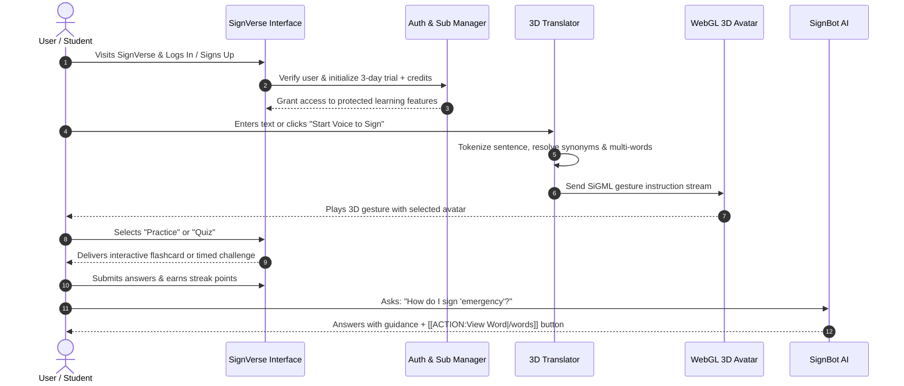

# SignVerse 🤟 - Complete Platform Walkthrough & Architecture Guide

Welcome to the comprehensive walkthrough document for **SignVerse**, the next-generation 3D Sign Language translation, education, and accessibility platform.

---

## 📑 Table of Contents
1. [Platform Overview & Mission](#1-platform-overview--mission)
2. [Technology Stack](#2-technology-stack)
3. [Architecture & Data Flow](#3-architecture--data-flow)
4. [Step-by-Step Feature Walkthrough](#4-step-by-step-feature-walkthrough)
   - [4.1 3D Avatar Sign Synthesizer & Translator](#41-3d-avatar-sign-synthesizer--translator)
   - [4.2 Voice-to-Sign & Speech Pipeline](#42-voice-to-sign--speech-pipeline)
   - [4.3 Interactive Fingerspelling Studio (A–Z)](#43-interactive-fingerspelling-studio-az)
   - [4.4 12,000+ Word Sign Dictionary](#44-12000-word-sign-dictionary)
   - [4.5 Gamified Flashcard Practice Arena](#45-gamified-flashcard-practice-arena)
   - [4.6 60-Second Timed Quiz Arena](#46-60-second-timed-quiz-arena)
   - [4.7 SignBot AI Conversational Assistant](#47-signbot-ai-conversational-assistant)
   - [4.8 Analytics Dashboard & Daily Streak Tracker](#48-analytics-dashboard--daily-streak-tracker)
   - [4.9 Pricing, Credits & Subscription System](#49-pricing-credits--subscription-system)
5. [User Journey & Workflow](#5-user-journey--workflow)
6. [Repository & Codebase Structure](#6-repository--codebase-structure)
7. [Installation & Local Run Guide](#7-installation--local-run-guide)
8. [Production Deployment](#8-production-deployment)

---

## 1. Platform Overview & Mission

**SignVerse** bridges the communication barrier between the Deaf/Hard-of-Hearing community and the hearing world. By combining real-time speech recognition, natural language processing, 3D WebGL computer graphics, and Large Language Models, SignVerse transforms everyday communication into natural, fluid British Sign Language (BSL) and Indian Sign Language (ISL) animations.

### Core Value Pillars:
- **Zero-Friction Accessibility**: Operates directly in standard web browsers without requiring heavy standalone software or external hardware.
- **Bi-Directional Learning**: Enables both translation (hearing to deaf via 3D sign synthesis) and structured sign mastery (fingerspelling, vocabulary, flashcards, and quizzes).
- **Gamified Habit Formation**: Keeps learners engaged with daily streak trackers, interactive roadmaps, and timed arenas.

---

## 2. Technology Stack

| Layer | Technologies |
| :--- | :--- |
| **Frontend Framework** | [React 19](https://react.dev/), [Vite 8](https://vitejs.dev/), [React Router DOM v7](https://reactrouter.com/) |
| **3D Rendering & Animation Engine** | WebGL Avatar Synthesizer ([CWASA / JASigning](file:///c:/Users/SINGH/Desktop/SignVerse/public/player-applet.html)), [Three.js](https://threejs.org/), `@react-three/fiber` |
| **Animation Notation Format** | **SiGML** (Signing Gesture Markup Language based on HamNoSys) |
| **AI / Large Language Models** | **Groq API** (`llama-3.3-70b-versatile`) with fallback to **Google Gemini 1.5 Flash** |
| **Browser APIs** | Web Speech API (`SpeechRecognition`), Web Speech Synthesis (`speechSynthesis` TTS), `localStorage` Persistence |
| **Design & UI System** | Custom responsive CSS3 design system with mobile navigation drawer, fluid grid layouts, and glassmorphism styling |

---

## 3. Architecture & Data Flow

```mermaid
flowchart TD
    User([User Voice or Text Input]) --> InputHandler{Input Type}
    
    InputHandler -->|Voice| SpeechAPI[Web Speech Recognition API]
    InputHandler -->|Text| TextParser[Text Normalization & NLP Engine]
    SpeechAPI --> TextParser

    TextParser --> MultiWordMatch[Multi-Word Phrase Tokenizer]
    MultiWordMatch --> SynonymResolver[Synonym & Slang Normalizer]
    SynonymResolver --> DictLookup{O(1) Map Lookup}
    
    DictLookup -->|Direct Match| SiGMLExtractor[Fetch SiGML Gesture File]
    DictLookup -->|Unmatched Word| FingerspellFallback[Fingerspelling Generator A-Z]
    
    FingerspellFallback --> SiGMLExtractor
    SiGMLExtractor --> CWASAEngine[CWASA 3D WebGL Player Applet]
    CWASAEngine --> AvatarRender[Render Gesture on 3D Avatar: Luna / Marc / Anna / Siggi]

    User -.->|Query / Chat| SignBot[SignBot AI Assistant]
    SignBot --> AIModelSelector{API Key Check}
    AIModelSelector -->|Groq Key| GroqLLM[Groq Llama-3.3 70B]
    AIModelSelector -->|Gemini Key| GeminiLLM[Google Gemini 1.5 Flash]
    AIModelSelector -->|Offline / No Key| LocalRules[Local Sign Engine]
    GroqLLM --> ChatOutput[Markdown Response + TTS Voice Playback]
    GeminiLLM --> ChatOutput
    LocalRules --> ChatOutput
```

---

## 4. Step-by-Step Feature Walkthrough

### 4.1 3D Avatar Sign Synthesizer & Translator
- **File Reference**: [`src/pages/translate.jsx`](file:///c:/Users/SINGH/Desktop/SignVerse/src/pages/translate.jsx)
- **Engine Container**: [`public/player-applet.html`](file:///c:/Users/SINGH/Desktop/SignVerse/public/player-applet.html)
- **Features**:
  - High-performance 3D character avatars: **Luna**, **Marc**, **Francoise**, **Anna**, and **Siggi**.
  - Renders XML-based SiGML files describing manual hand shapes, palm orientations, hand locations, facial expressions, and timing.
  - Variable speed controls: **Slow (1.5x delay)**, **Normal (1.0x)**, and **Fast (0.7x)** for learners of all skill levels.
  - Interactive camera controls: rotate, pan, and zoom around the avatar to inspect 3D hand postures from any angle.

### 4.2 Voice-to-Sign & Speech Pipeline
- **File Reference**: [`src/pages/translate.jsx`](file:///c:/Users/SINGH/Desktop/SignVerse/src/pages/translate.jsx#L63-L120)
- **Features**:
  - Direct integration with browser Web Speech Recognition for hands-free real-time translation.
  - Multi-word phrase matching (e.g., `"thank you"`, `"good morning"`, `"how are you"`).
  - Built-in synonym dictionary (e.g., `"dad"` ➔ `"father"`, `"kids"` ➔ `"children"`, `"hi"` ➔ `"hello"`).
  - Automatic letter-by-letter fingerspelling fallback for proper nouns and technical terms not found in the vocabulary database.

### 4.3 Interactive Fingerspelling Studio (A–Z)
- **File Reference**: [`src/pages/alphabets.jsx`](file:///c:/Users/SINGH/Desktop/SignVerse/src/pages/alphabets.jsx)
- **Features**:
  - Complete 26-letter sign alphabet grid with high-resolution gesture representations.
  - Single-click to animate any letter immediately on the 3D avatar.
  - Keyboard shortcut navigation (press any letter key A–Z to trigger instant sign playback).
  - Step-by-step visual descriptions of finger positioning for learners.

### 4.4 12,000+ Word Sign Dictionary
- **File Reference**: [`src/pages/words.jsx`](file:///c:/Users/SINGH/Desktop/SignVerse/src/pages/words.jsx) & [`src/modulesData.json`](file:///c:/Users/SINGH/Desktop/SignVerse/src/modulesData.json)
- **Features**:
  - Organized by intuitive categories: *Greetings*, *Family*, *Emergency*, *Food*, *Numbers*, *Emotions*, *Common Phrases*, and *Animals*.
  - Instant search bar with instant filter and search feedback.
  - Preview card modal showing gesture breakdown and quick avatar replay.

### 4.5 Gamified Flashcard Practice Arena
- **File Reference**: [`src/pages/practice.jsx`](file:///c:/Users/SINGH/Desktop/SignVerse/src/pages/practice.jsx)
- **Features**:
  - Anti-cheating visual concealment: gesture animations play first while hiding the English answer until the user decides to reveal.
  - Spaced repetition self-rating system (**"Easy"**, **"Good"**, **"Hard"**).
  - Dynamic score counter and review queue for mastering tricky signs.

### 4.6 60-Second Timed Quiz Arena
- **File Reference**: [`src/pages/quiz.jsx`](file:///c:/Users/SINGH/Desktop/SignVerse/src/pages/quiz.jsx)
- **Features**:
  - Fast-paced 60-second time trial to test sign comprehension under pressure.
  - Live streak tracking with streak multiplier bonuses.
  - Accuracy percentage metrics and rank progression from *Sign Novice* to *Sign Master*.
  - Post-quiz review session highlighting correct answers and learning tips.

### 4.7 SignBot AI Conversational Assistant
- **File References**: [`src/components/AIChatBot.jsx`](file:///c:/Users/SINGH/Desktop/SignVerse/src/components/AIChatBot.jsx) & [`src/utils/aiBotEngine.js`](file:///c:/Users/SINGH/Desktop/SignVerse/src/utils/aiBotEngine.js)
- **Features**:
  - Floating multimodal AI assistant accessible across every screen in the application.
  - Powered by **Groq Llama-3.3 70B** with intelligent fallback to **Google Gemini 1.5 Flash** and offline rule-based responses.
  - Integrated Text-to-Speech (TTS) voice playback for audible pronunciation.
  - Interactive in-chat action buttons (`[[ACTION:Learn Alphabets|/alphabets]]`) that navigate the user directly to the relevant tool.

### 4.8 Analytics Dashboard & Daily Streak Tracker
- **File References**: [`src/pages/dashboard.jsx`](file:///c:/Users/SINGH/Desktop/SignVerse/src/pages/dashboard.jsx) & [`src/utils/streakManager.js`](file:///c:/Users/SINGH/Desktop/SignVerse/src/utils/streakManager.js)
- **Features**:
  - Daily active streak counter with automated freeze protection and consecutive day badges.
  - Progress charts across vocabulary, quizzes taken, and minutes practiced.
  - Achievement badge showcase with unlock criteria.

### 4.9 Pricing, Credits & Subscription System
- **File References**: [`src/pages/pricing.jsx`](file:///c:/Users/SINGH/Desktop/SignVerse/src/pages/pricing.jsx) & [`src/utils/subscriptionManager.js`](file:///c:/Users/SINGH/Desktop/SignVerse/src/utils/subscriptionManager.js)
- **Features**:
  - Out-of-the-box 3-Day Free Trial granting full access and starting credits (🪙 100).
  - Tiered membership model: Free Trial, Pro Scholar, and Enterprise Accessibility.
  - Credit consumption model for advanced AI features and real-time translations.

### 4.10 Gamified Course Roadmap & Dynamic Lesson Engine
- **File References**: [`src/data/courseData.json`](file:///c:/Users/SINGH/Desktop/SignVerse/src/data/courseData.json), [`src/components/CourseRoadmap.jsx`](file:///c:/Users/SINGH/Desktop/SignVerse/src/components/CourseRoadmap.jsx), [`src/components/LessonEngine.jsx`](file:///c:/Users/SINGH/Desktop/SignVerse/src/components/LessonEngine.jsx), [`src/components/CWASA3DAvatar.jsx`](file:///c:/Users/SINGH/Desktop/SignVerse/src/components/CWASA3DAvatar.jsx)
- **Features**:
  - **Winding Gamified Trail**: Duolingo-style vertical path with alternating nodes, status badges, and XP counters.
  - **Tiered Unlocking**: Level 1 (Free) is immediately accessible; Level 2 (Premium) and beyond display lock badges.
  - **Mock Payment Modal**: Glassmorphism demo modal offering Premium Access for ₹499 with a "Simulate Payment (Demo)" button that permanently unlocks levels via `localStorage`.
  - **Dynamic Lesson Activities**:
    - **`multiple-choice`**: Button options with immediate green/red feedback and explanations.
    - **`drag-drop`**: Interactive letter tiles and target slots for fingerspelling ("The Name Game").
    - **`visual-select`**: Emoji/card visual selection for grocery and marketplace signs ("The Grocery Run").
  - **Embedded 3D Avatar Synthesizer**: Replay button, slow-motion speed controls (1.5x / 1.0x), and interactive camera inspection.

---

## 5. User Journey & Workflow



---

## 6. Repository & Codebase Structure

```text
SignVerse/
├── index.html                   # HTML entry point with WebGL player scripts
├── vite.config.js               # Vite build and dev server configuration
├── package.json                 # Project dependencies and script runner
├── README.md                    # Repository introduction and overview
├── WALKTHROUGH.md               # Complete platform architecture and walkthrough guide
│
├── public/                      # Static assets and WebGL player applet
│   ├── player-applet.html       # CWASA WebGL SiGML player iframe
│   ├── SignFiles/               # Individual SiGML gesture definition files
│   ├── DictionarySigns/         # Core dictionary sign animations
│   ├── avatars/                 # 3D avatar mesh and texture definitions
│   └── icons.svg / favicon.svg  # Vector graphics and brand icons
│
└── src/                         # React Application Source
    ├── App.jsx                  # Root router, navigation bar & layout shell
    ├── App.css / index.css      # Core design tokens, dark/light themes & responsive layout
    ├── modulesData.json         # Vocabulary and gesture categorization database
    │
    ├── components/
    │   └── AIChatBot.jsx        # Floating AI conversational assistant widget
    │
    ├── pages/
    │   ├── home.jsx             # Hero landing page with feature cards
    │   ├── alphabets.jsx        # Interactive Fingerspelling Studio (A–Z)
    │   ├── words.jsx            # Categorized Sign Dictionary & search
    │   ├── translate.jsx        # 3D Voice & Text to Sign Translator
    │   ├── practice.jsx         # Gamified flashcards with spaced repetition
    │   ├── quiz.jsx             # 60-Second Timed Arena with live ranking
    │   ├── dashboard.jsx        # Learner analytics & streak tracker
    │   ├── pricing.jsx          # Subscription plans & credits shop
    │   ├── login.jsx            # User sign-in screen
    │   └── signup.jsx           # Account registration screen
    │
    └── utils/
        ├── aiBotEngine.js       # Groq & Gemini API client with fallback logic
        ├── streakManager.js     # Daily streak calculations and badge rewards
        └── subscriptionManager.js # Credit balance and trial validity manager
```

---

## 7. Installation & Local Run Guide

### Step 1: Clone and Enter the Directory
```bash
git clone https://github.com/Kirat23018/SignVerse.git
cd SignVerse
```

### Step 2: Install Node Dependencies
Ensure **Node.js (v18+)** is installed on your workstation:
```bash
npm install
```

### Step 3: Configure Environment Variables (Optional for AI)
Create a `.env` file in the project root:
```env
# Groq API Key (Recommended for ultra-fast Llama-3.3 70B inference)
VITE_GROQ_API_KEY=your_groq_api_key_here

# Or Google Gemini API Key
VITE_GEMINI_API_KEY=your_gemini_api_key_here
```
*(Note: If no API keys are provided, SignBot automatically utilizes local rule-based knowledge).*

### Step 4: Start the Development Server
```bash
npm run dev
```
Navigate to `http://localhost:5173` in your browser.

---

## 8. Production Deployment

To generate an optimized production bundle:
```bash
npm run build
```
The compiled static assets will be output to the `dist/` directory, ready for deployment on **Vercel**, **Netlify**, or **GitHub Pages**. A preconfigured [`vercel.json`](file:///c:/Users/SINGH/Desktop/SignVerse/vercel.json) is already included for clean single-page app routing.

---
*Created for Hackathon 2026. Made with ❤️ by the SignVerse Team.*
